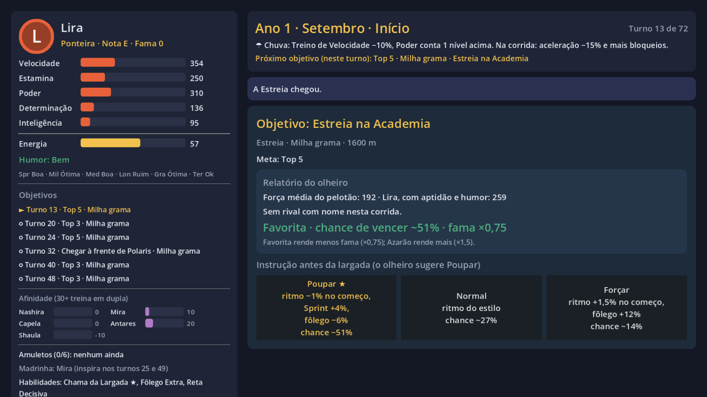

# Nekomusume: Corrida Purrfeita (stelar-gallop)

Simulador de treino e corrida de garotas gato. O design está em [docs/GDD.md](docs/GDD.md).

## Protótipo jogável (Godot 4.7)

O projeto Godot fica na raiz do repositório. Para jogar, abra o `project.godot` no Godot 4.7
e aperte F5, ou rode:

```
Godot_v4.7.2-stable_win64.exe --path .
```

**O que dá para fazer:** escolher a primeira garota entre 3 iniciais, conhecer outras na pool
semanal e jogar com qualquer garota do elenco uma carreira de 72 turnos (3 anos, um turno por
meio mês), seguindo o [calendário](docs/calendario.md) e as [campanhas](docs/campanhas.md):

- **Semestre de base:** os turnos 1 a 12 são só treino e encontros. A Estreia é no turno 13.
- **Campanha única:** 8 objetivos (turnos 13, 20, 24, 32, 40, 48, 60 e 72), com os 3 Grandes
  Prêmios no fim de cada ano. As 6 garotas do MVP têm campanha escrita à mão, e as outras 42
  usam um de 12 arquétipos. Capítulos de história aparecem em turnos fixos, e depois do GP do
  ano 2 a carreira segue um de 2 caminhos, cada um com objetivo 7, GP final e final próprios.
  Falhou um objetivo, acabou.
- **Calendário fixo:** 16 corridas Prata e Ouro com nome, nos anos 2 e 3, que dá para correr
  em qualquer nó do mapa.
- **Mapa de rotas:** entre um objetivo e outro você escolhe um caminho num mapa sorteado de
  3 colunas. Cada nó dura 2 turnos: Treino focado, Circuito (corridas geradas), Festival,
  Recuperação, Biblioteca, Desafio (corrida de elite) ou Mistério (6 eventos).
- **Fama e categorias:** Estreia, Aberta, Prata, Ouro e Grande Prêmio. As mais altas pedem fama
  nas opcionais (os objetivos são por convite), e o pelotão fica mais forte a cada ano.
- **Clima do mês** (seis climas, conforme a estação), **férias de verão** com acampamento na
  Serra ou na Praia e **véspera** com a rival antes dos Grandes Prêmios.
- **Amuletos:** cada objetivo cumprido (do 1 ao 7) e o top 3 num Desafio dão a escolha de
  1 entre 3 amuletos (4, com um raro garantido, nos objetivos difíceis). São 15, de 4 tipos
  (simples, troca, estilo e raro), com até 6 equipados. Valem só até o fim da carreira.
- **Habilidades:** corridas dão um pouco de atributos e pontos de habilidade, que compram genéricas na loja da
  carreira (10 no total, até 6 equipadas; a Biblioteca dá 30% de desconto). Ela começa com
  Fôlego Extra e Reta Decisiva, e a versão salva guarda as habilidades.
- **Olheiro e instrução:** antes de toda corrida o olheiro mostra a força média do pelotão, se
  há rival e a etiqueta **Favorita / Disputada / Azarão** pela chance estimada de vencer. A fama
  vale ×0,75 / ×1 / ×1,5, então arriscar rende mais. Antes da largada você escolhe **Poupar,
  Normal ou Forçar**, e o olheiro sugere a que tem mais chance.
- **Séries e títulos:** vencer conjuntos de corridas do calendário fixo dá títulos (Estrela da
  *distância*, Coroa Dupla, Volta ao Céu) com fama, amuleto, aptidão ou +1 espaço de amuleto.
  Os títulos ficam na versão salva.
- **Madrinha:** com garotas salvas no elenco, a carreira começa pela escolha da madrinha, que dá
  um bônus inicial (teto de +25 por atributo com o vínculo) e inspira nos turnos 25 e 49.
- **Semente:** todos os sorteios saem da semente da carreira; recarregar e repetir a mesma
  ação dá o mesmo resultado.

A corrida é assistida em 3D (primitivas placeholder), com
ranking ao vivo, minimapa, avisos de habilidade e botões 1x / 2x / pular.

**Câmeras da corrida:** Automática (troca sozinha conforme a fase, como numa transmissão),
Acompanhar, Lateral, Frente, Aérea e Tribuna. Troque com `C` ou com as teclas `1` a `6`.

**Encontros e afinidade:** em algumas semanas (mais ao Sair) aparece um encontro com 2 ou 3
escolhas. Há 3 eventos únicos por inicial e 6 genéricos com as colegas da academia, todos em
`data/encontros.json`. Os encontros mexem na afinidade, e colegas com afinidade 30+ podem
aparecer num treino para um bônus de dupla (+25%). As rivais Polaris e Algol, ou a campeã
da casa, correm os Grandes Prêmios e os objetivos com meta de rival.

**Save:** a carreira é salva sozinha a cada turno (`user://carreira.json`). Na tela inicial
aparece o botão para continuar.

**Academia, pool e vínculo:** entre carreiras você fica na academia, com a moeda e o elenco.
A pool semanal mostra 5 garotas (2 com eventos e 3 só com dados), com chances iguais e
visíveis. Cada tiragem custa 100 moedas. Marque uma garota e ela vem garantida em no máximo
10 tiragens. Garota repetida sobe o vínculo (até 5), que dá +4 em cada atributo inicial e
+40 no limite por nível. A rotação gira a cada carreira concluída. No fim da carreira você
recebe moeda (prêmios das corridas e bônus por objetivo) e decide se a nova versão substitui
a salva. O perfil fica em `user://perfil.json`.

**Fica para depois:** magnitude, liberar amuletos entre carreiras e o circuito de copas.
A arte é placeholder (formas coloridas).

| Arquivo | O que faz |
|---|---|
| `scripts/sim_corrida.gd` | Simulação da corrida, port fiel de [corrida.md](docs/corrida.md) e `tools/sim_corrida.py`. Não depende de tela. |
| `scripts/calendario.gd` | Datas, trechos, mapa de rotas, clima, calendário fixo e corridas geradas, tudo pela semente. |
| `scripts/campanha.gd` | Monta a campanha de cada garota (`data/campanhas.json`) e avalia o ponto de virada. |
| `scripts/carreira.gd` | Regras da carreira. Os números de balanceamento ficam em `BAL`. |
| `scripts/perfil.gd` | Moeda, elenco, vínculo, versão salva de cada garota e a pool. |
| `scripts/dados.gd` | Autoload que carrega os arquivos de `data/` (elenco, iniciais, rivais, encontros). |
| `scripts/corrida_3d.gd`, `scripts/pista_geo.gd` | Vista 3D da corrida (pista, corredoras, câmeras) e a geometria da pista em metros. |
| `scripts/tela_*.gd`, `scripts/main.gd` | Telas montadas em código (escolha, madrinha, carreira com olheiro, corrida, fim). |
| `testes/balanco.gd` | Joga carreiras completas com um bot (conta nova ou madura) e mede objetivos, virada, curva de atributos e fama. |
| `testes/teste_campanhas.gd` | Monta as 48 campanhas e confere turnos, rivais, aptidões e o save depois da virada. |
| `testes/teste_amuletos.gd` | Testa oferta, limite e efeitos dos amuletos e a loja de habilidades. |
| `testes/teste_mapa.gd` | Gera 1400 mapas e confere as regras do sorteio. |
| `testes/teste_perfil.gd` | Testa a pool, a garantia, o vínculo, a moeda do fim de carreira e o save do perfil. |
| `testes/teste_save.gd` | Salva uma carreira, carrega de volta e confere se o estado é o mesmo. |
| `testes/teste_series.gd` | Testa o olheiro, a instrução, as séries e títulos, o teto da madrinha e o visual do elenco. |
| `testes/instrucao.gd` | Compara as 3 instruções em corridas equilibradas e mede o erro do olheiro contra corridas reais. |
| `testes/capturas.gd` | Passa pelas telas sozinho e salva capturas em `testes/capturas/`. |
| `testes/capturas_novas.gd` | Capturas da madrinha, do olheiro, dos cartões de corrida e dos títulos. |
| `tools/importar_visual.py` | Lê as fichas de [visual-elenco.md](docs/visual-elenco.md) e grava signo, aniversário e visual em `data/garotas.json` e `data/rivais.json`. |

### Testes

```
Godot_v4.7.2-stable_win64_console.exe --headless --path . --script res://testes/balanco.gd -- 20 mvp nova
Godot_v4.7.2-stable_win64_console.exe --headless --path . --script res://testes/teste_campanhas.gd
Godot_v4.7.2-stable_win64_console.exe --headless --path . --script res://testes/teste_save.gd
Godot_v4.7.2-stable_win64_console.exe --headless --path . --script res://testes/teste_perfil.gd
Godot_v4.7.2-stable_win64_console.exe --headless --path . --script res://testes/teste_mapa.gd
Godot_v4.7.2-stable_win64_console.exe --headless --path . --script res://testes/teste_amuletos.gd
Godot_v4.7.2-stable_win64_console.exe --headless --path . --script res://testes/teste_series.gd
Godot_v4.7.2-stable_win64_console.exe --headless --path . --script res://testes/instrucao.gd -- 40
Godot_v4.7.2-stable_win64_console.exe --path . --script res://testes/capturas.gd
```

Com 30 carreiras por garota, o bot cumpre os objetivos em ~80% / 56% / 45% / 38% / 26%
(acumulado), e a média dos atributos nos objetivos fica perto da curva do calendário
(~160 / 260 / 425 / 520 / 745). O bot é simples; quem planeja a rota e cuida do humor vai melhor.





## Outras ferramentas

- `tools/`: simulador de corrida e gerador do elenco em Python (ver [corrida.md](docs/corrida.md) §9).
- `visualizador/`: visualizador da corrida no navegador.
- MCPs do [Godot](docs/mcp-godot.md) e do [Blender](docs/mcp-blender.md) para o Claude Code.
