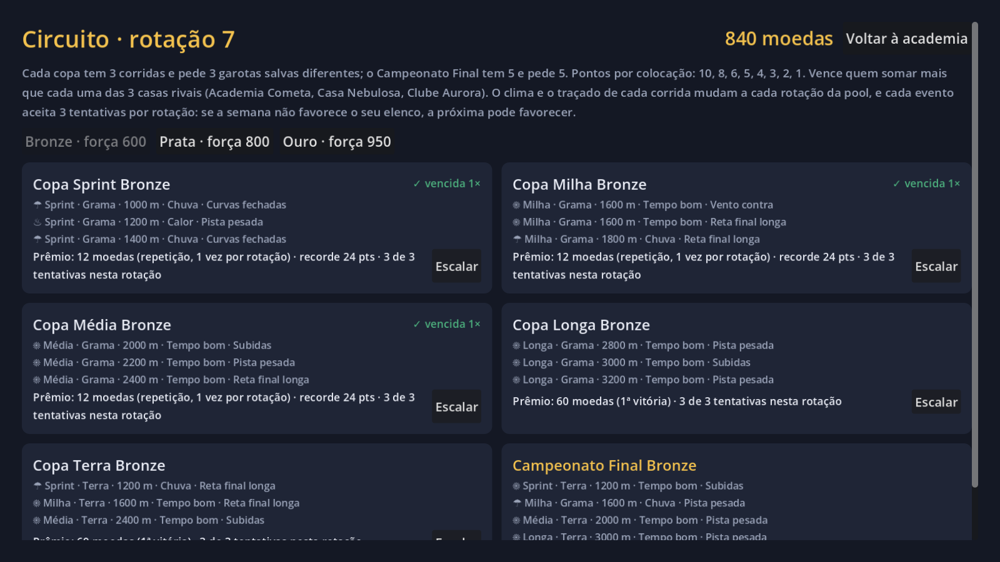
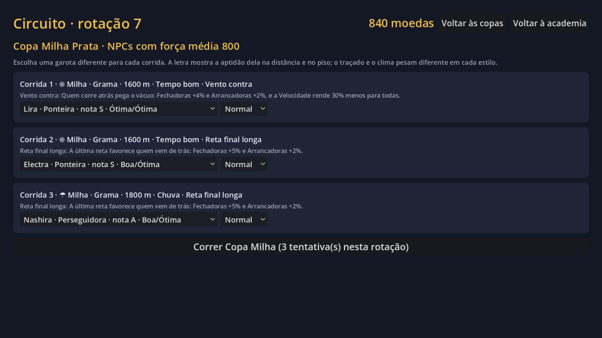
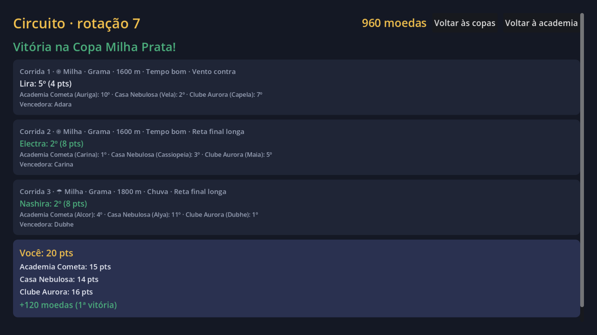

# Nekomusume — Endgame

> Versão 0.2 — 2026-11-20. Na v0.2 os traçados foram recalibrados para a simulação nova (fôlego do pelotão e correção de estilo por nível, [corrida](corrida.md) §6 e §8.5), que tirou o domínio da Velocidade (§5.2 e §5.6).
> Versão 0.1 — 2026-11-19. Detalha o endgame previsto em [campanhas](campanhas.md) §2.3: **Magnitude** ([calendário](calendario.md) §10), **Circuito em níveis** ([GDD](GDD.md) §7) e **Desafio da semana**, como estão no protótipo, e o balanceamento feito para não existir um meta (§5).
> Valores marcados com **(inicial)** são pontos de partida para balanceamento. Todos os números ficam em `data/endgame.json`.

O endgame é o que o jogador faz depois de ter um elenco salvo. Os três modos usam coisas diferentes:

| Modo | Usa | Recompensa | Onde |
|---|---|---|---|
| **Magnitude** | Uma garota, numa carreira mais difícil | Moeda extra e a estrela na ficha | Cartão da garota na academia |
| **Circuito** | As versões salvas do elenco | Moeda (1ª vitória e repetição semanal) | Botão "Circuito" na academia |
| **Desafio da semana** | Uma carreira igual para todo mundo | Recorde da semana e moeda na 1ª tentativa | Painel roxo na academia |

Código: `scripts/endgame.gd` (regras), `scripts/perfil.gd` (progresso salvo), `scripts/tela_circuito.gd` (tela do circuito) e mudanças pequenas em `carreira.gd`, `tela_academia.gd`, `tela_carreira.gd`, `tela_fim.gd` e `main.gd`. Testes em `testes/teste_endgame.gd` e medições em `testes/meta_circuito.gd`.

---

## 1. Magnitude

Como no [calendário](calendario.md) §10: dificuldade **0 a 5 por garota**. Vencer o GP final na maior magnitude liberada libera a próxima. O jogador escolhe a magnitude no cartão da garota, na academia (o seletor só aparece depois da primeira liberação).

| Magnitude | O que muda (acumula) |
|---|---|
| 0 | Normal. |
| 1 | NPCs +5% de força. |
| 2 | 1 maldição sorteada (não ocupa vaga de amuleto). |
| 3 | As metas sobem um degrau: top 5 vira top 3, top 3 vira vitória (vale também para os objetivos dos 2 caminhos). |
| 4 | NPCs +10% no total e rivais com nome +25% em vez de +15%. |
| 5 | 2 maldições, e cada trecho tem 1 nó de Recuperação a menos (vira Treino focado). |

**Maldições (inicial)**

| Maldição | Efeito |
|---|---|
| Coleira Frouxa | 5% de chance de falha em todo treino, mesmo com energia cheia |
| Torcida Exigente | Fama −20% em toda corrida |
| Insônia | Descanso recupera −15% |
| Nuvem Carregada | Um 2º sorteio de chuva com a chance da estação (a chance p vira 2p − p²) |
| Bolso Furado | Prêmios em moeda das corridas −30% |

- A **Má Fama** do calendário (primeiro encontro de cada trecho sempre ruim) virou **Bolso Furado**: mexer no resultado dos encontros pedia mudar o sistema de encontros, que outra frente estava mexendo. Dá para voltar com ela depois.
- **Recompensas:** +20% de moeda no fim da carreira por nível (aparece na tela de fim) e a estrela "GP final vencido na Magnitude N" no cartão. A magnitude **não** deixa a garota salva mais forte.
- **Fica para depois:** os amuletos e Mistérios exclusivos de cada magnitude.
- Tudo sai da semente da carreira: o save guarda só as opções (`magnitude`, `regra`, `desafio`) e a carreira recarregada repete as mesmas maldições, metas e mapa.
- O bot de balanceamento aceita `MAGNITUDE=n` para jogar na magnitude n.

## 2. Circuito em níveis

### 2.1 Estrutura

- **5 copas** de 3 corridas (Sprint, Milha, Média, Longa e Terra) e o **Campeonato Final** de 5 corridas, cada um em **Bronze, Prata e Ouro**.
- O jogador escala **garotas salvas diferentes** em cada corrida (3 por copa, 5 no Final) e escolhe a instrução de cada uma.
- **Abertura:** Bronze aberto desde o começo. O Prata de uma copa abre com o Bronze dela vencido, o Ouro com o Prata. O Final de um nível abre com as 5 copas daquele nível vencidas (e, a partir do Prata, com o Final do nível anterior).
- **Força das NPCs (inicial):** Bronze 600, Prata 800, Ouro 950 (média dos atributos, antes da aptidão).

| Evento | Corridas |
|---|---|
| Copa Sprint | Grama 1000 / 1200 / 1400 m |
| Copa Milha | Grama 1600 / 1600 / 1800 m |
| Copa Média | Grama 2000 / 2200 / 2400 m |
| Copa Longa | Grama 2800 / 3000 / 3200 m |
| Copa Terra | Terra 1200 / 1600 / 2400 m (GDD §7) |
| Campeonato Final | Sprint terra 1200, Milha grama 1600, Média terra 2000, Longa terra 3000 e Longa grama 3200 m |

As distâncias variam dentro de cada copa porque a distância muda qual estilo rende mais (as fases da corrida têm tamanho proporcional, menos o Sprint final de 400 m). O Final tem 3 corridas de terra para dar lugar às especialistas de terra, que só tinham a Copa Terra: assim todas as 8 casas (distância × piso) têm pelo menos 1 corrida onde são as melhores.

### 2.2 Como se vence

- Cada corrida tem 12 corredoras: a da jogadora, **1 de cada casa rival** (Academia Cometa, Casa Nebulosa, Clube Aurora) e 8 avulsas.
- As casas escalam, em cada corrida, as garotas do elenco geral com a melhor aptidão para ela, sem repetir no evento e sem usar as da jogadora. Correm com força ×0,98 a ×1,05 do nível; as avulsas, ×0,85 a ×1,00.
- **Pontos por colocação:** 10, 8, 6, 5, 4, 3, 2, 1 (do 9º para baixo, nada). A jogadora vence se somar **mais pontos que cada casa**. No empate, vence a menor soma de colocações.
- **3 tentativas por evento em cada rotação da pool.** Sem limite, bastava repetir até a sorte ajudar e a força do elenco não pesava.
- **Prêmio (inicial):** 1ª vitória Bronze 60, Prata 120, Ouro 200 moedas (Final ×3). Repetir dá 20%, uma vez por rotação (e não na mesma rotação da 1ª vitória).

### 2.3 Condições da semana

Cada corrida tem um **clima** (tempo bom 60%, chuva 25%, calor 15%) e um **traçado**, sorteados a cada rotação da pool. A semente não usa o perfil, então na mesma rotação todo jogador vê as mesmas condições. O traçado muda a física da corrida igual para todas, mas cada um deixa outro atributo ou estilo mais valioso (§5):

| Traçado | Peso | Efeito | Quem ganha |
|---|---|---|---|
| Pista padrão | 1 | Nenhum | Empate entre os estilos (desde a correção de estilo, [corrida](corrida.md) §8.5) |
| Pista pesada | 2 | Fôlego da distância ×0,8; Fechadoras +1,5% | De 2400 m para cima, Estamina e Inteligência valem mais que Velocidade |
| Subidas | 2 | Aceleração ×0,4 e Velocidade ×0,8 | Poder vale mais que Velocidade; Arrancadoras |
| Vento contra | 1 | Velocidade ×0,7; Fechadoras +2%, Arrancadoras +1% | Poder, Determinação e Inteligência pesam mais |
| Reta final longa | 1 | Fechadoras +3%, Arrancadoras +1% | Fechadoras |
| Curvas fechadas | 1 | Ponteiras +3%, Perseguidoras +2% | Quem corre na frente |

A tela de escalação mostra o traçado e o clima de cada corrida e a aptidão de cada garota. A escalação já vem sugerida (maior média de atributos × aptidão), só como ponto de partida.

## 3. Desafio da semana

- A cada rotação da pool há um desafio: **semente fixa, garota fixa e uma regra**. A semente não usa o perfil, então na mesma rotação todo jogador tem a mesma carreira (mesmo mapa, clima e pelotões).
- Corre com **vínculo 0 e sem madrinha**, para as condições serem iguais. A garota pode ser qualquer uma das 48, mesmo fora do elenco.
- **Não guarda versão salva e não gira a pool**: dá para tentar de novo até a rotação mudar. A moeda da carreira só vem na 1ª tentativa concluída da semana.
- O **placar** compara objetivos cumpridos, depois vitória no GP final, depois fama. A academia mostra o melhor da semana.
- As regras giram em ordem embaralhada por ciclo, sem repetir em semanas seguidas:

| Regra | Efeito |
|---|---|
| Sempre chove | Todo turno é de chuva (treino e corrida) |
| Só Pratas | Das corridas opcionais, só as Pratas ficam abertas |
| Bolsa pequena | No máximo 2 amuletos |
| Lua negra | Começa com 2 maldições |
| Pelotão de elite | Todas as NPCs com +10% de força |

## 4. Telas

- **Academia:** botão Circuito, painel do desafio da semana (garota, regra, recorde, tentativas e se a moeda já veio) e, no cartão de cada garota, o seletor de magnitude e a estrela.
- **Circuito:** abas Bronze/Prata/Ouro, cartão por evento (corridas com clima e traçado, prêmio, tentativas restantes, recorde, o que falta para abrir), escalação com garota e instrução por corrida, e o resultado corrida a corrida com as casas e o placar.
- **Carreira:** uma linha vermelha no painel da garota com magnitude, maldições e regra do desafio (o detalhe fica no tooltip).
- **Fim:** a linha da moeda mostra o bônus da magnitude; no desafio, mostra o placar, o recorde e um botão só ("Concluir desafio").

| Academia | Circuito | Escalação | Resultado |
|---|---|---|---|
|  |  |  |  |

## 5. Balanceamento sem meta

Lucas pediu que o endgame não tenha um meta definido: nenhum estilo, garota, atributo ou escalação que seja sempre a melhor. O circuito é onde isso pesa, porque é onde o elenco salvo é usado.

### 5.1 Como medi

`testes/meta_circuito.gd` corre a garota da jogadora contra o pelotão real de cada corrida do circuito, em semanas sorteadas (casas e avulsas mudam), e mede os pontos médios. Três modos:
- **estilo:** os 4 estilos com o mesmo perfil (todos os atributos iguais) e aptidão Ótima/Ótima;
- **garota:** as garotas do elenco com aptidão para a corrida, cada uma com o próprio perfil, todas com a mesma média;
- **attr:** +10% em um atributo por vez, para ver quanto cada atributo vale.

Todas as variantes de uma mesma rodada usam a **mesma semente** (números aleatórios comuns): a diferença entre elas é efeito do estilo ou atributo, não da sorte. Sem isso, com 60 corridas por variante, o ruído era maior que os efeitos.

### 5.2 O que a simulação faz sozinha

> As §5.2 a §5.4 foram medidas com a simulação até a v0.6. A §5.6 tem as medições com a simulação nova e os traçados de hoje.

Com atributos em 800 (o fim de carreira típico) e o traçado padrão:

| +10% em | Pontos a mais por corrida (média de 6 corridas, 1200 a 3200 m) |
|---|---|
| Velocidade | +0,90 |
| Poder | +0,38 |
| Determinação | +0,27 |
| Inteligência | +0,23 |
| Estamina | **0,00** |

- **Velocidade é o melhor atributo em quase toda corrida**, até nos 3200 m.
- **Estamina não muda nenhuma colocação**, em nenhuma distância: com Est 800 o fôlego nunca acaba (o fôlego máximo é 0,6 × distância + 1,5 × Estamina, e sobra).
- Entre os estilos, Perseguidora ≈ Ponteira > Arrancadora > Fechadora (5,3 / 5,3 / 5,0 / 4,8 pontos).
- Com as garotas reais, as de perfil puxado para Velocidade (como a Electra) vencem em mais corridas.

Isso é da simulação e vale também para a carreira, onde vira um meta de "treinar Velocidade". Mexer na simulação muda todo o balanceamento das campanhas, então ficou como achado para a frente de balanceamento (§7). No endgame, o contrapeso são os traçados.

### 5.3 Traçados testados

Pontos a mais por +10% em cada atributo, média de 6 corridas (1200 a 3200 m), 40 rodadas por variante:

| Traçado | Vel | Est | Pod | Det | Int | Melhor estilo |
|---|---|---|---|---|---|---|
| Padrão | +0,90 | 0,00 | +0,38 | +0,27 | +0,23 | Per ≈ Pon |
| Pesada (fôlego da distância ×0,35) | +0,45 | **+0,51** | +0,18 | +0,23 | +0,43 | Pon |
| Subidas (acel ×0,4, Vel ×0,8) | +0,64 | 0,00 | **+0,76** | +0,20 | +0,20 | Arr |
| Vento contra (Vel ×0,7) | +0,72 | 0,00 | +0,39 | +0,27 | +0,23 | empate |
| Reta final (Fec +3,5%, Arr +1,5%) | +0,90 | 0,00 | +0,37 | +0,28 | +0,24 | Fec |
| Curvas (Per +2%, Pon +1%) | +0,93 | 0,00 | +0,39 | +0,27 | +0,22 | Per |

Na pista pesada, nas corridas de 2400 m para cima, a Estamina passa a ser o melhor atributo (+1,0 a +1,2) e a Velocidade cai para +0,2 a +0,4.

**Descartados** (não mudaram nada que a medição pegasse):
- **Lama** (teto de velocidade ×0,8): deixava a Velocidade *mais* valiosa, porque o teto também cresce com a Velocidade. Com teto absoluto, só esmagava as Fechadoras.
- **Pista estreita** (bloqueio ×2,5 e ×6): o bloqueio é raro demais na simulação para pesar.
- **Curvas por Inteligência** (Int ×1,3 para todas): escalar o atributo de todo mundo quase não muda o valor de ter mais que as outras.

### 5.4 Resultado com os traçados finais

Os valores finais ficaram mais fortes que os da tabela acima para as Fechadoras (a reta foi a +5%, o vento ganhou +4%, a pista pesada ganhou Fechadoras +3%) e as curvas passaram a favorecer as Ponteiras, porque a primeira rodada nas 20 corridas ainda deixava as Fechadoras atrás.

Pontos médios por estilo nas **20 corridas** do circuito, com o perfil neutro (todos os atributos 800, aptidão Ótima), média ponderada pelo peso de cada traçado (40 rodadas por variante):

| Estilo | Antes dos traçados (padrão) | Traçados v3 | **Final** | Melhor estilo em (% das corridas × traçados) |
|---|---|---|---|---|
| Ponteira | 4,93 | 5,03 | **4,99** | 28% |
| Perseguidora | 4,95 | 5,13 | **5,03** | 10% |
| Arrancadora | 4,75 | 5,06 | **5,07** | 44% |
| Fechadora | 4,49 | 4,82 | **4,92** | 18% |

- A diferença entre o melhor e o pior estilo caiu de **10%** (só pista padrão) para **3%**. Isso equivale a ~3% de Velocidade: menos que a diferença entre aptidão Boa e Ótima (5%) ou entre duas versões salvas da mesma garota.
- Cada traçado tem um estilo que ganha: padrão e curvas na frente, subidas com as Arrancadoras, reta e vento com as Fechadoras, pista pesada mais perto do empate.
- Por copa, o melhor estilo muda: Longa e Média com Ponteiras e Perseguidoras, Sprint, Milha e Terra com Arrancadoras, e a diferença fica entre 2% e 7%. Como as condições mudam toda rotação, a escalação boa desta semana não é a da próxima.
- A Perseguidora raramente é a melhor, mas também quase nunca é a pior: é o estilo "seguro".
- **Atributos:** a Velocidade continua sendo o melhor atributo em 4 dos 6 traçados (é da simulação, §5.2). Na pista pesada de 2400 m para cima a Estamina passa na frente, e nas subidas o Poder. Com os pesos, ~1 em cada 4 corridas da semana pede outro atributo que não a Velocidade.

**Com as garotas reais** (perfil da ficha de cada uma, todas com média 800 e só as que têm aptidão para a corrida, 20 rodadas por traçado):

- A melhor garota de cada corrida só é a melhor em **46%** dos traçados, em média. Nas outras semanas, outra garota da mesma casa passa na frente.
- Estilo da melhor garota, ponderado pelos traçados: Ponteira 38%, Fechadora 35%, Perseguidora 14%, Arrancadora 12%.
- O caso mais forte é a **Electra na Copa Sprint** (a melhor em 75% dos traçados), porque o perfil dela é o mais puxado para Velocidade e Poder entre as velocistas. Nas outras copas, nenhuma garota passa de 62%.
- No jogo, a versão salva tem os atributos que o jogador treinou, não o perfil da ficha, então isso pesa menos do que parece: o perfil só define os treinos naturais (+10%).


### 5.5 Dificuldade de cada nível

Chance de vencer cada evento com um elenco de aptidão Ótima em todas as corridas e atributos de média M, em semanas sorteadas (30 tentativas por célula, habilidades iniciais):

| Média M | Bronze | Prata | Ouro |
|---|---|---|---|
| 700 | 63–87% | 0–7% | 0% |
| 800 | 93–100% | 7–37% | 0–3% |
| 850 | 93–100% | 27–60% | 0–3% |
| 900 | 97–100% | 47–77% | 0–13% |
| 950 | 100% | 77–93% | 7–23% |
| 1000 | 100% | 93–100% | 43–67% |
| 1100 | 100% | 93–100% | 80–90% |

- Fim de carreira típico: média ~820 na conta nova e ~870 na madura ([campanhas](campanhas.md) §7). O **Bronze** cai com as primeiras garotas salvas, o **Prata** fica perto de 50% para a conta madura (com 3 tentativas, ~80% de vencer na semana) e o **Ouro** pede média ~1000, que só o vínculo alto alcança (limite 1000 + 40 por nível de vínculo). É o que campanhas §2.3 pedia: o lugar onde a garota forte e o vínculo 5 fazem diferença.
- A Copa Terra e o Campeonato Final são os mais difíceis de cada nível, porque misturam distâncias.

### 5.6 Com a simulação nova (2026-11-20)

O fôlego do pelotão ([corrida](corrida.md) §6) e a correção de estilo por nível ([corrida](corrida.md) §8.5) mudaram a física que os traçados compensavam. Tudo medido de novo com `meta_circuito.gd`, nível 800.

**Atributos** (+10% num atributo, 40 rodadas por variante):

| Corrida | Traçado | Vel | Est | Pod | Det | Int |
|---|---|---|---|---|---|---|
| Sprint 1200 m | Padrão | **+0,58** | +0,01 | +0,35 | +0,01 | +0,04 |
| Longa 3200 m | Padrão | +0,41 | +0,43 | −0,08 | +0,30 | **+0,45** |
| Sprint 1200 m | Pesada (×0,8) | **+0,58** | +0,01 | +0,47 | +0,01 | −0,02 |
| Longa 3200 m | Pesada (×0,8) | +0,62 | **+1,48** | +0,24 | +0,55 | +1,02 |

- A Velocidade deixou de valer mais que tudo. Nos 3200 m da pista padrão, Velocidade, Estamina e Inteligência valem o mesmo, e na média das 5 distâncias Vel +0,79, Est +0,77 e Int +0,73 ([corrida](corrida.md) §8.6).
- **Pista pesada:** com o fôlego da distância ×0,35, a Sprint virava outra corrida. As velocistas do pelotão (Estamina baixa) ficavam sem fôlego, o perfil equilibrado vencia 80% das corridas (2,5% na pista padrão) e nenhum atributo mudava nada. Com ×0,8, a Sprint pesada fica como a padrão e, de 2400 m para cima, a Estamina vale mais que o dobro da Velocidade.

**Estilos** (perfil neutro, as 20 corridas, média ponderada pelo peso dos traçados, 30 rodadas por variante):

| Medição | Ponteira | Perseguidora | Arrancadora | Fechadora | Diferença | Melhor estilo em (% das corridas × traçados) |
|---|---|---|---|---|---|---|
| Simulação antiga, traçados da v0.1 (§5.4) | 4,99 | 5,03 | 5,07 | 4,92 | 3% | 28 / 10 / 44 / 18 |
| Simulação nova, traçados da v0.1 | 6,03 | 5,97 | 6,20 | 6,29 | 5,4% | 23 / 7 / 26 / **44** |
| **Simulação nova, traçados de hoje** | **5,69** | **5,70** | **5,84** | **5,80** | **2,7%** | 30 / 7 / 31 / 32 |

*Os pontos só se comparam dentro da mesma linha.*

- A correção de estilo deixou a pista padrão quase empatada (2,5%, era 10%), e os bônus das Fechadoras, pensados para tirá-las do último lugar, passaram a sobrar. Ficaram: pista pesada com Fechadoras +1,5% (era +3%, e o +1,5% das Arrancadoras saiu), vento +2% e +1% (era +4% e +2%), reta +3% e +1% (era +5% e +2%) e curvas com Ponteiras +3% e Perseguidoras +2% (era +2% e +1%).
- Por traçado, cada um ainda tem o seu: subidas com as Arrancadoras (a maior diferença, 14,6%), curvas com as Ponteiras, reta com as Fechadoras. A pista pesada (1,8%) e o vento (1,5%) mudam o atributo que vale, não o estilo.
- Por copa, a diferença fica entre 2,9% (Final e Terra) e 5,2% (Longa).

**Garotas reais** (perfil da ficha, todas com média 800, 20 rodadas por traçado):

- A melhor garota de cada corrida é a melhor em **53%** dos traçados, em média (era 46%).
- Estilo da melhor, ponderado pelos traçados: Fechadora 45%, Ponteira 36%, Perseguidora 10% e Arrancadora 9% (era 35 / 38 / 14 / 12).
- O caso mais forte segue sendo a **Electra na Copa Sprint**: a melhor em 83% dos traçados nos 1200 m (era 75%). Fora dela, a Bellatrix na Copa Terra e a Shaula nos 3000 m do Final chegam a 69%.
- Como na §5.4, a versão salva tem os atributos que o jogador treinou, não o perfil da ficha, então isso pesa menos do que parece.

**Níveis** (como na §5.5, 30 tentativas por célula): quase igual ao de antes. Com média 800, Bronze 93–100%, Prata 7–37% e Ouro 0–3%. Com 950, Prata 80–90% e Ouro 7–30%. Com 1000, Ouro 50–67%.

## 6. Como rodar

```
# testes do endgame (também rodam no rodar_testes.gd e no GitHub)
Godot --headless --path . --script res://testes/teste_endgame.gd

# meta: modo, rodadas, média, parte i/n, saída, climas, traçados, corridas
for i in 0 1 2 3; do Godot --headless --path . --script res://testes/meta_circuito.gd -- estilo 40 800 $i/4 estilo_$i.json bom todos & done; wait
Godot --headless --path . --script res://testes/meta_circuito.gd -- attr 40 800 0/1 attr.json bom padrao,pesada sprint:1,longa:2
Godot --headless --path . --script res://testes/meta_circuito.gd -- nivel 30 0 0/1 nivel.json

# bot da carreira numa magnitude
MAGNITUDE=3 Godot --headless --path . --script res://testes/balanco.gd -- 20 mvp madura
```

## 7. Pendências

- ~~**Simulação:** a Estamina não pesa e a Velocidade domina (§5.2).~~ Resolvido em 2026-11-20 com o fôlego do pelotão ([corrida](corrida.md) §6), e os traçados foram recalibrados (§5.6). Quando a simulação mudar de novo, rode `meta_circuito.gd` (estilo, attr e nivel) e confira a §5.6.
- **Garotas reais:** a Electra na Copa Sprint (a melhor em 83% dos traçados) e as Fechadoras como as melhores garotas reais (45%), medidas com o perfil da ficha (§5.6). Vale medir com versões salvas de verdade, saídas do bot, antes de mexer no elenco.
- Medir a carreira em cada magnitude com o bot (`MAGNITUDE=n`) e ajustar a tabela do §1.
- Amuletos e Mistérios exclusivos de magnitude (calendário §10).
- O circuito ainda não mostra a corrida em 3D: o resultado sai direto. Dá para reaproveitar a `TelaCorrida`.
