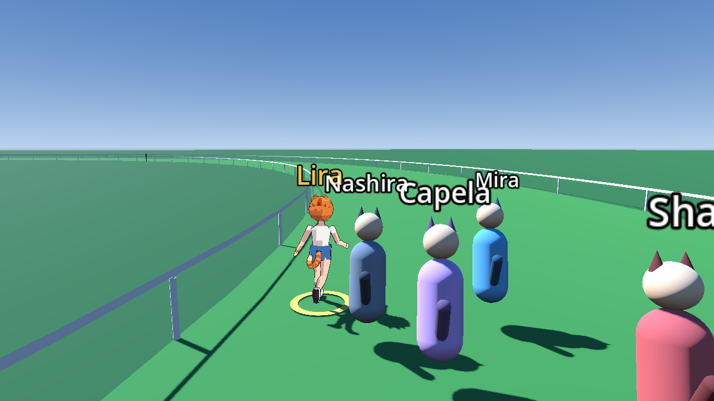

# Lira: a garota de referência em 3D low-poly

> Versão 0.2, 2026-11-18 (estilo revisto a partir dos vídeos de referência, ver "Estudo das referências").
> Versão 0.1, 2026-11-18. Primeira tarefa de arte do [GDD](GDD.md) §11.4: uma garota passando
> pelo pipeline inteiro (Blender → glTF → Godot) antes de produzir as outras.
> A ficha visual dela está no [visual do elenco](visual-elenco.md) §4.1.




## Estudo das referências

Os dois vídeos que o Lucas mandou (GDD §11.1): a série de 14 vídeos de personagem low-poly anime
no Blender (modelagem por caixa com espelho, rosto com faca, cabelo em blocos, UV e textura pintada,
Rigify, pesos e rosto 2D trocável) e o personagem estilo PS1 (textura pequena e serrilhada).
O que entrou na Lira v0.2:

| Na referência | Na Lira |
|---|---|
| Cabeça grande, corpo com ~5 cabeças de altura | Cabeça 25% maior e corpo mais baixo e robusto (`ESCALA_CORPO`) |
| Cabelo é um volume maior que o crânio, cortado em mechas grandes e chapadas | Calota 1,13× a cabeça, franja de 5 mechas largas até os olhos, laterais emoldurando o rosto, nuca serrilhada e o espetado atrás |
| Olhos enormes pintados na textura do rosto, com cílio grosso e 2 brilhos | Olhos ~35% maiores no atlas, sobrancelhas acima |
| Sombra e brilho **pintados** na textura, sem depender da luz | Paleta com 4 tons por cor (luz, base, sombra rosada, sombra funda); cada face pega o tom pela direção; no Godot o material é sem luz |
| Contorno preto em volta do personagem | Casco invertido (`Lira_Contorno`), sem contorno onde as mechas entram no cabelo |
| Brilho em triângulos claros no topo do cabelo | 4 triângulos `brilho` no topo |
| Estilo PS1 | Fica como filtro opcional (GDD §11.1); a textura já é nearest e pequena |

## O que tem

| Item | Como ficou |
|---|---|
| **Malha** | 1.614 triângulos (mais ~1.330 do contorno), 1,60 m no Blender. |
| **Cor** | Textura de paleta 16 × 64: 16 cores em linhas, 4 tons em colunas. Cada face aponta a UV para a cor e o tom dela. Trocar a pelagem é trocar as linhas da paleta. |
| **Rosto** | Atlas 384 × 256 com as 6 expressões do MVP (normal, feliz, determinada, cansada, triste, surpresa). O rosto é uma malha fina na frente da cabeça; o Godot troca a expressão deslocando a UV. |
| **Ficha visual** | Cabelo curto e espetado atrás, franja com listras escuras (o "M" das rajadas), olhos verde-claros, orelhas pontudas viradas para frente com entalhe na esquerda, rabo grosso com anéis escuros e ponta clara em ponto de interrogação, munhequeira laranja, jaqueta azul amarrada na cintura, curativo no joelho direito e a estrela na camisa de corrida. |
| **Esqueleto** | 28 ossos (27 que deformam mais a raiz): corpo humanoide simples (quadril, coluna, peito, pescoço, cabeça, ombros, braços, pernas, pés), **2 orelhas** e **6 ossos de rabo**. Pesos feitos no script, sem pintura automática. |
| **Animações** | `parada` (48 quadros: respiração, rabo balançando, orelha tremendo) e `correr` (16 quadros: passada, braços, rabo esticado para trás, orelhas para trás). |

## Como gerar de novo

Tudo sai de um script só, sem mexer no Blender à mão:

```
"C:\Program Files\Blender Foundation\Blender 5.2\blender.exe" --background --factory-startup --python tools/blender/lira.py -- --render
```

Ele grava `modelos/lira.glb` (o que o Godot usa), `arte/lira.blend` (para editar à mão),
as texturas em `arte/` e prévias em `arte/previa/` (com `--render`). A pasta `arte/` tem
`.gdignore`, então o Godot não tenta importar o `.blend`.

No Godot:

- `scripts/modelo_garota.gd` (`ModeloGarota`) carrega o modelo, troca os materiais por sem luz com
  a paleta (filtro nearest) e o contorno, toca as animações em loop e troca a expressão.
- A corrida usa o modelo no lugar das cápsulas quando a garota tem um (só a Lira, por enquanto),
  com a animação `correr` no ritmo da velocidade e o rosto `determinada`.
- `cenas/vitrine_modelo.tscn` mostra a garota girando: 1–6 trocam a expressão, Espaço alterna
  parada/correr, setas giram.
- `testes/teste_modelo.gd` confere ossos, animações, materiais, triângulos e a troca de expressão.
- `testes/captura_modelo.gd` tira as capturas acima (com janela).

## Escolhas e pendências

- **Sem Rigify por enquanto.** O GDD fala em Rigify. Para a referência, o script monta direto um
  esqueleto de jogo (só ossos que deformam, nomes no padrão do Rigify sem o prefixo `DEF-`). Um rig
  de controle Rigify pode ser posto por cima depois, para animar à mão, sem mudar o que o Godot recebe.
- **Base única ainda não separada.** O script já tem as peças como funções (tronco, braço, perna,
  cabeça, orelha, rabo, cabelo). Para a próxima garota: separar o que é base, parametrizar orelha,
  rabo e cabelo pela ficha e trocar a paleta.
- **Sem luz do Godot.** A sombra é pintada, então o modelo não muda com o sol da pista nem com o clima.
  Se precisar escurecer à noite, multiplique `ModeloGarota.BRILHO`.
- **Mechas da franja** ainda deixam frestas pequenas de pele perto da testa em alguns ângulos.
- **Faltam animações:** andar, sprint, comemorar, perder, treinar e cochilar (GDD §11.2).
- **Escala na pista:** o modelo aparece com 2,15 m para combinar com as cápsulas (`Corrida3D.ALTURA_MODELO`).
  Quando todas tiverem modelo, dá para voltar à escala real.
