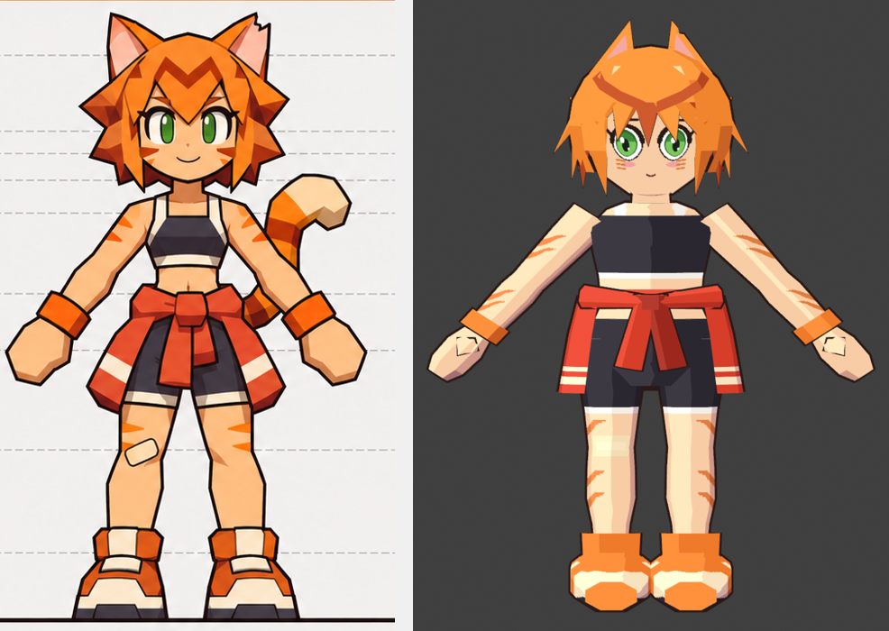
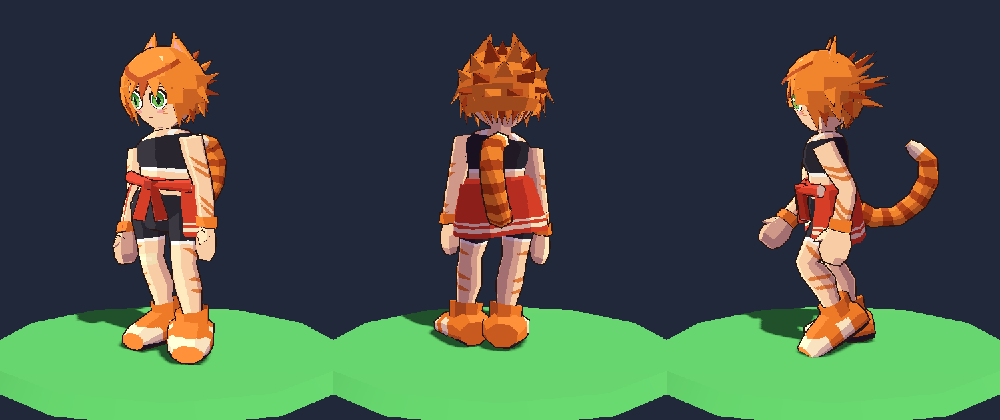
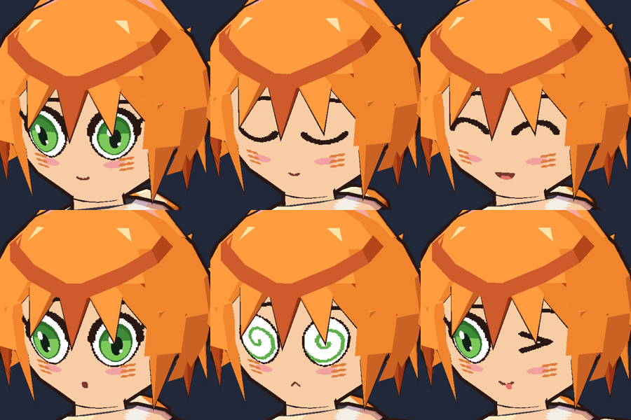

# Lira: a garota de referência em 3D low-poly

> Versão 0.3, 2026-11-18. Feita a partir da ficha conceitual da Lira e do PDF de pipeline
> que o Lucas subiu em `arte/` (estilo chunky retrô). Primeira tarefa de arte do [GDD](GDD.md) §11.4.
> A ficha escrita dela está no [visual do elenco](visual-elenco.md) §4.1.






## O que entrou da ficha e do PDF

| Fonte | O que pede | Como ficou |
|---|---|---|
| Ficha | Cabeça grande, corpo chunky, mão em luva, tênis grandões | Cabeça de 0,40 m de largura, corpo alargado 1,24 × 1,2 (`LARGURA_CORPO`), luvas com polegar, tênis com cano alto |
| Ficha | Top esportivo preto com alças e barra brancas, short preto com barra branca | Pintados na textura do tronco e das pernas |
| Ficha | Jaqueta vermelha amarrada na cintura, com listras creme na barra | Faixa, nó com as mangas e a "saia" aberta na frente |
| Ficha | Listras de gata na pele (braços, coxas, canelas e bochechas) e curativo no joelho direito | Pintadas na textura e no atlas do rosto |
| Ficha | Cabelo espetado com o "M" das rajadas em V na testa, orelha esquerda com entalhe, rabo listrado em interrogação | Capacete de cabelo com espetos, V escuro por cima, orelhas grandes, rabo grosso com anéis |
| Ficha | 6 expressões: normal, olhos fechados, feliz, surpresa, tonta, piscadinha com língua | Atlas 3 × 2 do rosto; a íris some ou aparece conforme a expressão |
| PDF §2 | Pernas de 5 lados, pescoço de 3, mão em cunha, cabelo como capacete + espetos, franja assimétrica | Seguido |
| PDF §3 | Textura em potência de 2, sombra pintada, material sem luz | Atlas 512 × 512: paleta (14 cores × 4 tons) + regiões pintadas por parte com sombra de 4 tons; material com emissão no Blender e sem luz no Godot; View Transform Standard |
| PDF §4–5 | Rig econômico, joelho para frente e cotovelo para trás, pesos chapados | 30 ossos: corpo humanoide, 2 orelhas, 6 de rabo e 2 de olho; pesos 1,0 por parte e 50/50 nas juntas |
| PDF §6 | Íris separadas presas a ossos de olho, rosto 2D por atlas | Íris em placas próprias (`eye.L`, `eye.R`); `ModeloGarota.olhar()` mexe os olhos |
| PDF §7 | 30 fps, ciclos fechados | Tudo a 30 fps |

## Animações

As 31 animações do Mixamo em `arte/animações/` são passadas para o esqueleto da Lira no próprio
Blender (`tools/blender/retarget_mixamo.py`): cada osso recebe a mesma variação de orientação
que o osso do Mixamo fez a partir da pose T, então o rig em pose A e as proporções diferentes
não atrapalham. As de andar e correr perdem o deslocamento para frente (ficam no lugar).
Rabo e orelhas, que o Mixamo não tem, ganham uma camada própria por tipo de animação.

| No jogo | Arquivo do Mixamo |
|---|---|
| `parada`, `andar`, `trote`, `correr`, `sprint`, `largada` | idle, Walking, Medium Run, Running, Fast Run, Idle To Sprint |
| `comemorar`, `animada`, `perder`, `pular` | Victory Idle, Excited, Defeated, jump |
| `treino_vel`, `treino_est`, `treino_pod`, `treino_det`, `treino_int` | Fast Run, Jumping Jacks, Air Squat, Burpee, Thinking |
| `prancha`, `sentar`, `bocejar`, `apoio` | Plank, Sitting, Yawn, weight shift |
| Gestos para encontros: `sim`, `nao`, `concordar`, `brava`, `irritada`, `convencida`, `desdenhar`, `gesto_feliz`, `suspiro`, `desviar_olhar`, `sarcasmo`, `pensativa` | head nod yes, shaking head no, acknowledging, angry gesture, annoyed head shake, being cocky, dismissing gesture, happy hand gesture, relieved sigh, look away gesture, sarcastic head nod, thoughtful head shake |

Na corrida a Lira usa `trote` abaixo de 15 m/s, `correr` no meio e `sprint` na fase final, com
o ritmo casado com a passada. Os gestos tocam uma vez; o resto fica em loop. Os arquivos de
virar e andar de lado (turn, strafe) e as cópias "(1)" ficaram de fora.

## Como gerar de novo

```
"C:\Program Files\Blender Foundation\Blender 5.2\blender.exe" --background --factory-startup --python tools/blender/lira.py -- --render
```

`--anims=parada,correr` gera só algumas animações (mais rápido para testar o visual);
`--sem-mixamo` pula o retarget. Saem `modelos/lira.glb`, `arte/lira.blend`, as texturas em
`arte/` e prévias em `arte/previa/`.

No Godot:

- `scripts/modelo_garota.gd` (`ModeloGarota`): materiais sem luz e contorno, `tocar()`,
  `expressao()`, `olhar()`, `duracao()`.
- `cenas/vitrine_modelo.tscn`: 1–6 trocam a expressão, Espaço/Backspace passam pelas animações,
  O liga o olhar passeando, setas giram.
- `testes/teste_modelo.gd` confere ossos, animações, materiais, íris e expressões;
  `testes/captura_modelo.gd` tira as capturas acima (com janela).
- Ao reimportar as texturas extraídas do glb, confira `detect_3d/compress_to=0` e
  `mipmaps/generate=false` nos `.import` de `modelos/` (o Godot tenta comprimir e borra a paleta).

## Pendências

- **As outras 7 fichas** (Nashira, Mira, Capela, Antares, Shaula, Polaris, Algol): mesma base;
  falta separar o que é base no script e parametrizar cabelo, orelhas, rabo, roupa e paleta.
- **Expressões:** o GDD listava normal, feliz, determinada, cansada, triste e surpresa; agora valem
  as 6 das fichas. Determinada, cansada e triste podem voltar num segundo atlas.
- **Cabelo de costas:** os espetos que apontam para trás parecem tachinhas quando vistos direto da nuca.
- **Escala na pista:** 2,15 m para combinar com as cápsulas (`Corrida3D.ALTURA_MODELO`).
- **Rigify:** o rig é próprio (nomes no padrão do Rigify sem `DEF-`). Um rig de controle pode vir
  por cima para animar à mão, sem mudar o que o Godot recebe.
