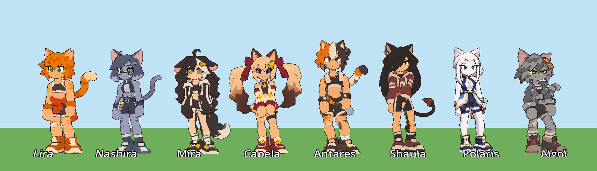
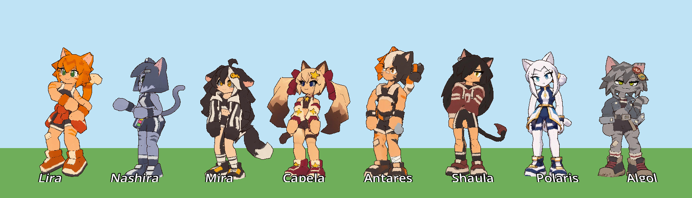
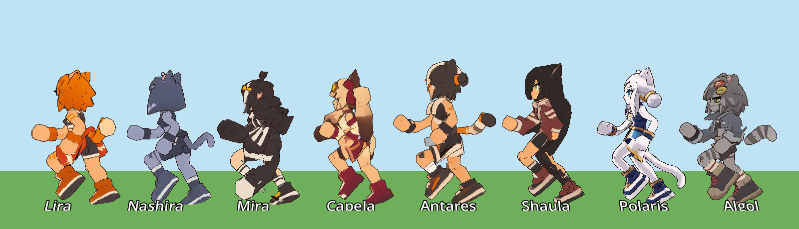
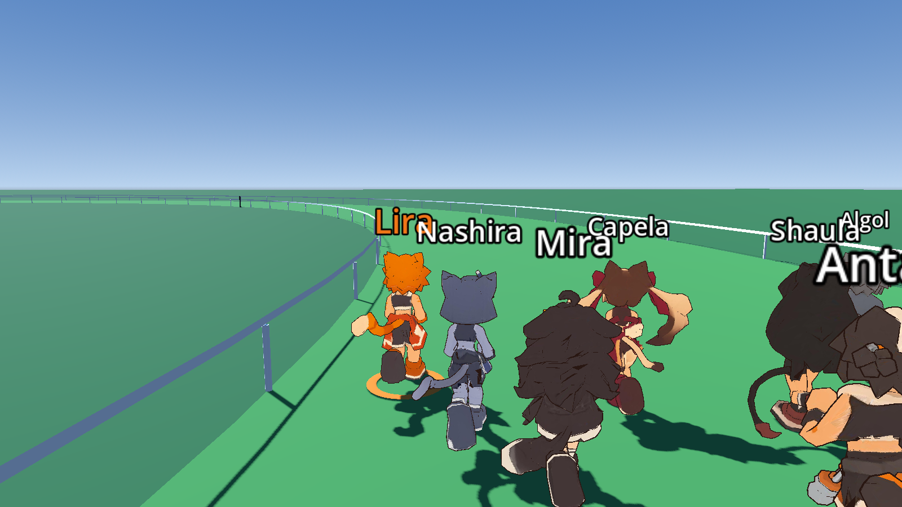
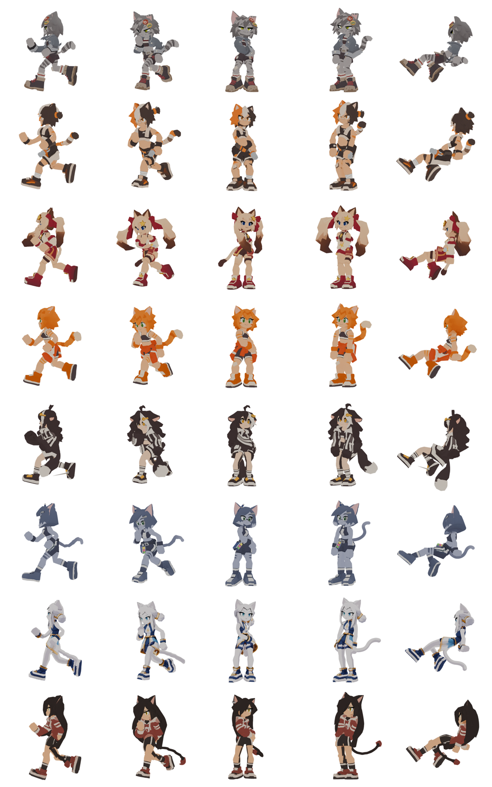

# Modelos 3D das garotas (Tripo → jogo)

> 2026-11-20. As 8 garotas do elenco principal (Lira, Nashira, Mira, Capela, Antares, Shaula,
> Polaris e Algol) agora correm com os modelos que o Lucas gerou no Tripo (`arte/3d/*.glb`),
> no lugar das cápsulas. Todas usam **o mesmo esqueleto** (o da Lira) e **as mesmas 31
> animações** do Mixamo.







## O que vem do Tripo e o que muda

| | Tripo (`arte/3d`) | No jogo (`modelos/<nome>.glb`) |
|---|---|---|
| Malha | ~2 milhões de triângulos (facetas chapadas subdivididas) | ~14 mil triângulos, mesma silhueta low-poly |
| Textura | 8192 px | 1024 px (JPEG embutido, o Godot extrai) |
| Arquivo | ~60 MB | ~2,6 MB |
| Esqueleto | nenhum | 29 ossos: humanoide do Mixamo, 2 orelhas e 6 de rabo |
| Animações | nenhuma | as 31 do `docs/modelo-lira.md` (parada, trote, correr, sprint, treinos, gestos...) |

O rosto e as íris estão pintados na textura do Tripo, então `ModeloGarota.expressao()` e
`olhar()` não fazem nada nesses modelos (os encontros continuam com os sprites das fichas).
O contorno escuro é uma segunda passada do material que cresce pela normal.

## Como refazer (ou importar uma garota nova)

Precisa só do Blender (ou do módulo `bpy` do PyPI). Dois passos por garota:

```
blender --background --python tools/blender/tripo_preparar.py -- arte/3d/Lira.glb /tmp/Lira.blend
blender --background --python tools/blender/tripo_rig.py -- /tmp/Lira.blend modelos/lira.glb "arte/animações"
```

1. **`tripo_preparar.py`** acha a frente (rabo e cabelo ficam atrás), põe de pé com 1,6 m,
   reduz a malha (Decimate) e a textura.
2. **`tripo_rig.py`** mede as juntas na malha (mãos, joelhos, tornozelos, pontas das orelhas),
   monta o esqueleto da Lira nessas posições, pesa (automático por calor), acha o rabo e
   passa as animações com `retarget_mixamo.py`.

O rabo é a parte mais difícil: o script segue a malha a partir da ponta (`PONTA_RABO`, um
ponto aproximado por garota) até onde ele sai do quadril e divide o caminho em 6 ossos.
Para uma garota nova, ponha a ponta do rabo dela nessa tabela. Faces que grudam o rabo numa
perna ou braço (o Tripo funde o que encosta) são removidas para não esticar.

## Limites conhecidos

- Mira: o rabo encosta no tênis; correndo aparece um fiozinho entre os pés em alguns quadros.
- Cabelo comprido (Mira, Shaula, Capela) segue a cabeça e o tronco, sem física.
- O pátio continua com os sprites das fichas; dá para trocar pelos modelos depois.
